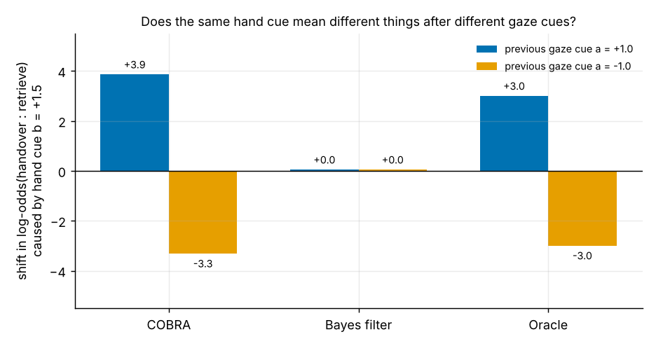
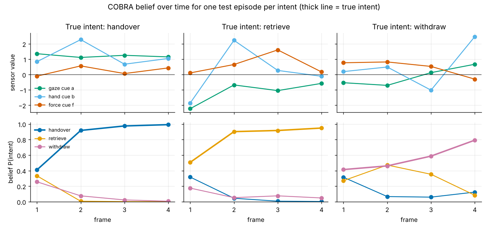
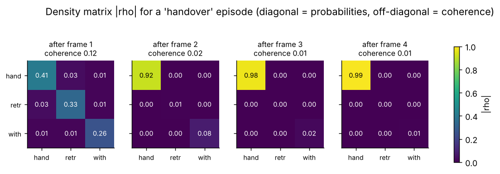
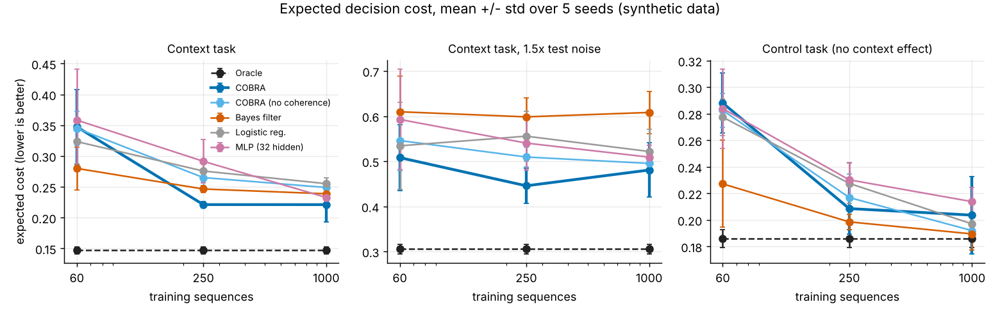

# COBRA — Coherent Order-sensitive Belief and Risk-aware Action

A small trainable belief filter for robot intent recognition, written in plain NumPy.

## What it does
The robot keeps a density matrix over hidden hypotheses (here: the human wants a *handover*, is *retrieving* their own tool, or is *withdrawing*). Each sensor frame updates it with a **context-rotated evidence operator** `M = U diag(w) U†`: `w` is ordinary Bayes-style evidence from the current frame, and the unitary `U` is driven by the **previous** frame, so what a reading means can depend on what came before it. A learned dephasing step controls how long phase information survives. Hypothesis probabilities are the diagonal of the matrix. A separate `min_cost_action` rule turns probabilities and an explicit cost matrix into `handover` / `wait` / `ask`.

Reference points: with `H = 0` COBRA is a classical Bayes filter; with dephasing `g = 1` it is a classical *incoherent* context-dependent filter. Both are tested.

Classical simulation only. No quantum-advantage claim, no motion commands, no safety guarantee.

## Files
- `cobra.py` – model (52 parameters, finite-difference Adam training with symmetry-breaking restarts)
- `baselines.py` – Bayes filter, logistic regression, MLP
- `benchmark.py` – synthetic generators, oracle, metrics (`python benchmark.py`, ~10 min on 4 cores)
- `visualize.py` – regenerates the figures in `figures/`
- `results/` – full tables and raw per-seed rows

## Benchmark summary (5 seeds, 3000 test sequences, synthetic data)
Two generators: **context** (meaning of one cue depends on the previous frame's gaze cue) and **control** (independent cues; a Bayes filter is near-optimal). Oracle knows the generator.

| Context task, 1000 training sequences | Accuracy | Expected cost (lower better) |
|---|---|---|
| Oracle | 0.898 | 0.147 |
| **COBRA** | **0.847 ± 0.023** | **0.221 ± 0.028** |
| COBRA, no coherence (ablation) | 0.816 ± 0.005 | 0.249 ± 0.010 |
| Bayes filter | 0.831 ± 0.006 | 0.239 ± 0.014 |
| Logistic regression | 0.814 ± 0.005 | 0.255 ± 0.009 |
| MLP (515 params) | 0.828 ± 0.011 | 0.233 ± 0.014 |

## Visualizing the model
Regenerate all figures with `python visualize.py` (needs `numpy` and `matplotlib`; trains one COBRA and one Bayes filter on the synthetic context task, about 1 minute). Figures are in `figures/`.

**1. What it learned: context-dependent meaning of a cue.** One hand cue `b = +1.5` is shown after a previous gaze cue of `+1.5` or `-1.5`. The plot shows only the shift in log-odds(handover : retrieve) that the hand cue adds, because the gaze cue is informative by itself. A Bayes filter adds the same amount either way (about 0). The oracle flips sign, and so does this trained COBRA. This is the clearest evidence that the context mechanism works, but it is one model (seed 0, 1000 training sequences); on other seeds the mechanism is sometimes not found (see below).

**2. Belief over time.** Sensor cues (top) and COBRA's belief in each intent after every frame (bottom), one correctly classified test episode per intent. The withdraw episode stays uncertain longer than the other two.

**3. The density matrix.** `|rho|` after each frame for a handover episode. The diagonal is the belief; off-diagonal cells are coherences. In this trained model the coherences are small (about 0.1 after frame 1 and about 0.01 afterwards), so most of the work is done by the context-rotated evidence step and the model is close to classical. This matches the weak coherence diagnostic (AUROC about 0.53) in the benchmark.

**4. Benchmark.** Expected decision cost against training size (mean and std over 5 seeds). COBRA is best at 250 and 1000 sequences on the context task and under 1.5x test noise, but the error bars overlap with the baselines in places, and it is worse than the Bayes filter at 60 sequences.

## Honest reading
- **Modest gain, not a win across the board.** With 1000 training sequences COBRA is ahead of every baseline on the context task, but the margin over the Bayes filter (~0.016 accuracy) is within COBRA's own seed-to-seed spread, and it is still far from the oracle.
- **Small data hurts.** With 60 training sequences COBRA is *worse* than the Bayes filter (0.726 vs 0.799 accuracy).
- **Robustness to noise (×1.5 test noise, 1000 train):** COBRA has the best calibration and cost among learned models (cost 0.481 vs Bayes 0.608, NLL 0.81 vs 1.01), but with high variance across seeds.
- **Control task:** COBRA matches the Bayes filter, as designed; it gains nothing there.
- **Coherence ablation:** removing coherence loses ~0.03 accuracy on the context task at 1000 sequences, a hint that phase interference helps, but not conclusive with 5 seeds.
- **The coherence diagnostic is not useful:** AUROC ≈ 0.53 for flagging errors; belief entropy (≈0.81) is far better.
- **Training is unreliable:** the context mechanism is only found on some restarts/seeds (saddle point), which causes the large variance.
- **Synthetic data only.** The context generator was written to contain the kind of interaction COBRA can represent; nothing here shows performance on real robot data.

## Next steps
Gradient-based (autodiff) training to remove the restart lottery; real handover/teleoperation datasets; stronger sequence baselines (GRU/transformer); more seeds for significance tests.
