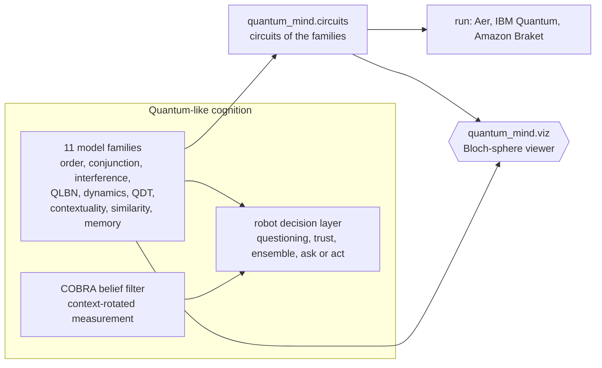

# Quantum-like models and what they are not

The word "quantum" is used in several senses. This library uses exactly one of them, and keeps it apart from
the others, because each makes a different claim and needs a different test.

| | Quantum-like (this library) | Quantum computing | Quantum-inspired algorithms |
|---|---|---|---|
| **What is modelled** | Human judgement, decision and trust; a robot's belief about a person | Any task posed as a quantum computation | Any optimisation or learning task |
| **Mathematics** | Quantum probability: state vectors and density matrices, projectors, generalised measurements, interference, open-system dynamics | Gate-model circuits: unitaries, measurement, parameterised ansatz | Classical algorithms that borrow a quantum idea |
| **Runs on** | Any computer (microseconds); optionally as a circuit | A quantum computer or a simulator of one | Any computer |
| **The claim** | People's answers violate classical probability in ways quantum probability predicts | A circuit solves or learns the task (advantage is open and problem-specific) | The quantum idea gives a useful heuristic |
| **How to test it** | Against classical cognitive models on human data: BIC, QQ equality, total-probability bounds, contextuality criteria | Against the exact answer and classical baselines; on hardware, against noise | Against classical heuristics with equal budgets |
| **In this library** | `quantum_mind.families`, `quantum_mind.belief`, `quantum_mind.applications` | Only the simulator and circuit exports needed to show and run the quantum-like models | Not included |

Quantum computing algorithms (VQE, QAOA, Grover, quantum kernels) and quantum-inspired optimisers are
provided and maintained by Qiskit, PennyLane and dedicated optimisation libraries, so this library does
not duplicate them. It concentrates on the first column.

## How the parts connect

- A quantum-like model is a set of vectors and projectors; `quantum_mind.circuits` turns it into a quantum
  circuit, so the same model can be executed on quantum hardware (a representation, not a speed-up).
- COBRA applies the same mathematics to the robot's own belief: a density matrix updated by generalised
  measurements whose basis depends on the previous frame.
- `quantum_mind.viz` draws any of them on Bloch spheres: circuit trajectories, the trust qubit of the
  open-system belief model, and states measured on real backends.

## Choosing

- Modelling **people** (answers, choices, trust, similarity)? Start with the quantum-like families and
  always fit the classical baselines next to them.
- A robot reading a **stream of sensor frames** whose meaning depends on context? Try `COBRA` next to the
  Gaussian Bayes filter, and look at the ablations before believing a gain.
- Studying **quantum computation** on a task, or teaching it? Use Qiskit or PennyLane directly; use this
  library's circuits to run a quantum-like model on hardware.
