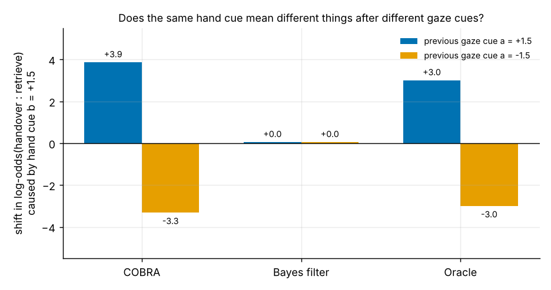

# COBRA belief filter (`quantum_mind.belief`)

A robot watching a person receives a stream of sensor frames. What a reading means often depends on what came
just before it: the same hand movement signals a hand-over after a look at the robot and a retrieval after a
look away. A classical Bayes filter treats the frames as conditionally independent and cannot represent that.
COBRA keeps the belief as a density matrix and lets the **previous frame rotate the basis** in which the next
frame is measured. The equations are on the [mathematics page](../../../docs/math/belief.md).

| Object | What it does |
|---|---|
| `COBRA(n_hyp, n_features)` | Trainable context-rotated density-matrix belief filter; `fit`, `predict_proba`, `trace`, `coherence`, `start` |
| `OnlineBelief` | The same filter one frame at a time: `update(frame)`, `probs`, `coherence` |
| `GaussianBayesFilter` | The commutative classical reference |
| `min_cost_action(probs, cost)` | Action with the lowest expected cost; give it an "ask" row to let the robot hedge |

```python
import numpy as np
from quantum_mind.belief import COBRA, GaussianBayesFilter, min_cost_action

model = COBRA(n_hyp=3, n_features=3).fit(frames, intent)    # frames (N, T, 3), intent in {0, 1, 2}
belief = model.start()                                       # online, as on a robot
for frame in sensor_stream:
    p = belief.update(frame)                                 # P(handover, retrieve, withdraw)

cost = np.array([[0, 6, 10], [1.5, 0, 0], [0.8, 0.8, 0.8]])  # hand over, wait, ask
action = min_cost_action(p, cost)[0]
```

## Two classical limits, built in

With `H = 0` (no rotation) COBRA *is* a Bayes filter; with full dephasing (`g = 1`) it is a classical
context-dependent filter with no phase between frames. Comparing the three isolates what the context
rotation and the coherence each add. The test suite checks both limits exactly
(`tests/test_math_docs.py`).

## Figures

**What it learned: context-dependent meaning of a cue.** The shift in log-odds(handover : retrieve) that one hand
cue adds after opposite previous looks. A Bayes filter adds the same amount either way; the oracle flips sign, and
so does this trained COBRA (one model, seed 0).



**Belief over time** for one correctly classified episode per intent:


**The density matrix** `|rho|` after each frame. The coherences are small (about 0.1 after the first frame, about
0.01 afterwards), so most of the work is done by the context-rotated evidence step.


**Benchmark.** Expected decision cost against training size (mean and std over 5 seeds):


## What is and is not claimed

* It is a **classical simulation** of the quantum-probability formalism and runs on NumPy. No quantum
  computational advantage is claimed.
* On a **synthetic** intent task built to contain a context effect, it lowers the expected decision cost by about
  0.02 against the Bayes filter with 250 to 1000 training sequences (a paired test is significant in only 2 of 5
  seeds) and is the best calibrated model under 1.5x test noise. With 60 training sequences it is worse (+0.07),
  on a control task with no context effect it is slightly worse than the Bayes filter (+0.01), and training
  sometimes misses the context mechanism (see `benchmarks/context_intent_benchmark.py` and its `results/`).
* The coherence of the belief is a **weak** error flag; belief entropy is far better.
* No study with real people or a real robot has been run.
